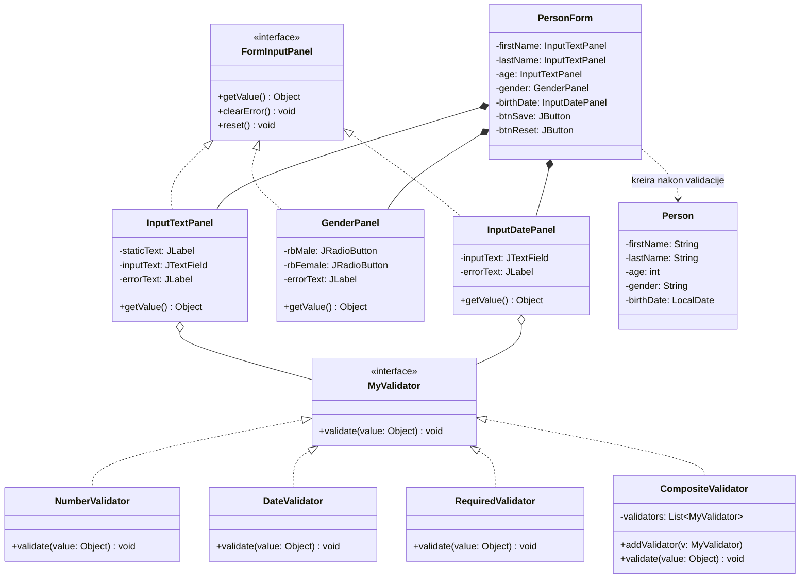

# Prvi Projekat - Softverski Paterni (1. Nastavna Nedelja)

Ovaj projekat predstavlja rešenje i proširenje zadatka sa 1. nastavne nedelje predmeta posvećenog projektnim uzorima (Softverski paterni). Projekat obuhvata rad sa Java Swing bibliotekom, kreiranje višekratno iskoristivih korisničkih komponenti (Reusable UI Components) i primenu uobičajenih projektnih uzora za validaciju korisničkog unosa.

---

## 1. Kontekst i cilj zadatka

### Polazno stanje sa časa:
Na času je analiziran problem dupliranja koda na formama kada imamo veći broj polja (labela za naziv, polje za unos i labela za grešku). Napravljena je osnovna komponenta `InputTextPanel` i interfejs `MyValidator` sa implementacijom `NumberValidator` za godine.

### Zahtev za domaći zadatak:
1. **Panel za unos pola (`GenderPanel`)**: Kreirati namensku komponentu za unos pola (radio dugmad za "Muški" i "Ženski").
2. **Panel za unos datuma rođenja (`InputDatePanel`)**: Kreirati namensku komponentu za unos i validaciju datuma (format `dd.MM.yyyy`).
3. **Unapređenja koda**: Otkloniti uočene nedostatke, poboljšati arhitekturu i primeniti dodatne uzore i principe čistog koda.

---

## 2. Arhitektura i primenjeni projektni uzori



### 1. Strategy Pattern (Uzor Strategija)
- **Interfejs:** `validator.MyValidator` definiše familiju algoritama za proveru ispravnosti unosa.
- **Konkretne strategije:**
  - `NumberValidator` - Proverava da li je unos ceo nenegativan broj.
  - `DateValidator` - Striktno proverava format (`dd.MM.yyyy`), postojanje datuma po kalendaru (onemogućava npr. 31.02) i da datum nije u budućnosti.
  - `RequiredValidator` - Proverava da li je polje popunjeno.
- **Prednost (Open/Closed Principle):** Nove validatore (npr. `EmailValidator`, `JMBGValidator`) možemo dodati bez menjanja ijedne linije koda u UI komponentama.

### 2. Composite Pattern (Uzor Kompozit)
- `validator.CompositeValidator` omogućava povezivanje više validatora u lanac. Jedno polje može istovremeno zahtevati da unos bude popunjen, numerički i u određenom opsegu.

### 3. Component & Polymorphic UI Pattern
- `component.FormInputPanel` obezbeđuje zajednički interfejs za sve ulazne panele (`InputTextPanel`, `GenderPanel`, `InputDatePanel`).
- Forma polimorfno pristupa komponentama za dobavljanje vrednosti (`getValue()`), čišćenje grešaka (`clearError()`) i resetovanje (`reset()`).

---

## 3. Struktura paketa i klasa

```
src/
├── component/
│   ├── FormInputPanel.java       <-- Zajednički interfejs za ulazne panele
│   ├── InputTextPanel.java       <-- Tekstualni unos (Ime, Prezime, Godine)
│   ├── InputTextPanel.form
│   ├── GenderPanel.java          <-- Unos pola preko radio dugmadi
│   ├── GenderPanel.form
│   ├── InputDatePanel.java       <-- Unos datuma rođenja
│   └── InputDatePanel.form
├── form/
│   ├── PersonForm.java           <-- Glavni prozor forme sa svim poljima
│   └── PersonForm.form
├── main/
│   └── Main.java                 <-- Ulazna tačka aplikacije (main metoda)
├── model/
│   └── Person.java               <-- Domenski model osobe
└── validator/
    ├── MyValidator.java          <-- Interfejs strategije validacije
    ├── NumberValidator.java      <-- Validacija celih brojeva
    ├── DateValidator.java        <-- Validacija datuma rođenja
    ├── RequiredValidator.java    <-- Validacija obaveznih polja
    └── CompositeValidator.java   <-- Kompozit više validatora
```

---

## 4. Ključna unapređenja u odnosu na čas

1. **Rešavanje baga sa brisanjem grešaka:**
   - U polaznom kodu greška je ostajala ispisana i nakon što korisnik unese ispravnu vrednost. Sada metoda `getValue()` na početku automatski poziva `clearError()`.
   - Sve greške se ispisuju u crvenoj boji (`Color.RED`).

2. **Paralelna (sveobuhvatna) validacija forme:**
   - Ranije je forma prekidala izvršavanje na prvoj grešci.
   - Sada se validiraju sva polja istovremeno, pa korisnik vidi sve greške odjednom ispod odgovarajućih polja.

3. **Logička provera (Business Rule Validation):**
   - Forma poredi uneti broj godina sa izračunatim godinama iz datuma rođenja (`Period.between(birthDate, LocalDate.now()).getYears()`). U slučaju neslaganja, korisnik dobija dijalog sa upozorenjem pre čuvanja.

4. **Domenski model `Person`:**
   - Uneti podaci se kapsuliraju u instancu klase `Person`.

5. **Dugme za poništavanje (`btnReset`):**
   - Jednim klikom polimorfno prazni sva polja i uklanja sve poruke o grešci.

6. **Puna NetBeans podrška:**
   - Kreirani su odgovarajući `.form` fajlovi za sve komponente i formu, što omogućava nesmetan rad u NetBeans GUI Builder-u.

---

## 5. Uputstvo za rad u NetBeans-u

Ukoliko ste otvorili NetBeans i izmene se nisu automatski učitale:
1. U meniju kliknite: **Source** -> **Scan for External Changes**.
2. Desni klik na projekat `PrviProjekatPaterni` -> **Clean and Build** (`Shift + F11`).
3. Ako je `PersonForm.java` već bio otvoren, zatvorite taj tab i otvorite ga ponovo dvoklikom iz `Source Packages` -> `form`.

---

## 6. Nastavak rada preko terminala (Antigravity CLI)

Ukoliko želite da ponovo pokrenete ili nastavite ovaj chat:
- **Nastavak poslednjeg chata:**
  ```powershell
  agy -c
  ```
- **Nastavak preko ID-ja ovog razgovora:**
  ```powershell
  agy --conversation 8cb14fe7-356c-4091-a516-d18bfcfbee72
  ```
